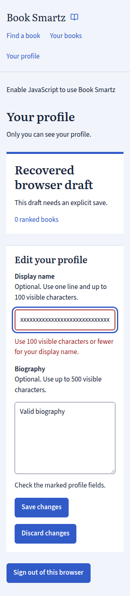
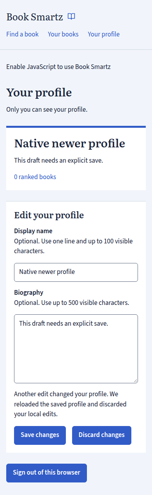
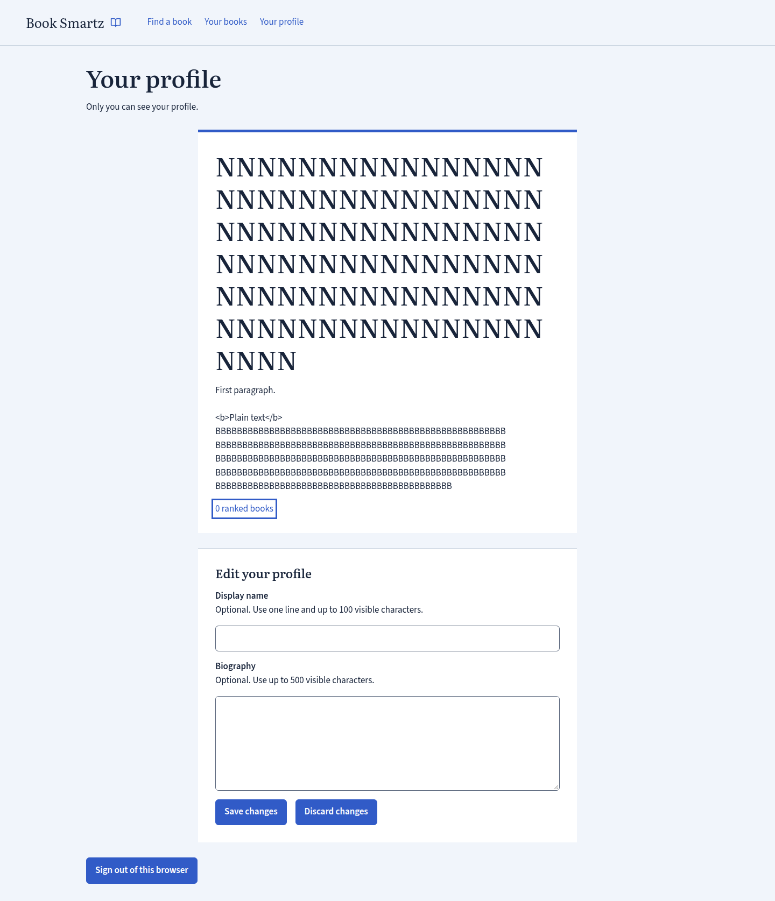

# Private profile acceptance

## Tested implementation

This record covers [#2925](https://github.com/LowkeyLab/bazel-repo/issues/2925) and the acceptance areas in [#2920](https://github.com/LowkeyLab/bazel-repo/issues/2920).
The tested implementation commit is `3446db7c2254cb81c558aafbf76cf21008d05451`.
Later evidence commits change only this report and its retained artifacts. They do not change app or test source.

The delivered archive runs with real isolated PostgreSQL and controlled signed Google responses.
The production identity client and token validation remain real. Each independent test creates its own fixture and database.
Chromium uses the same package through the existing TLS fixture. Native forms retain real redirects, secure cookies, and Origin checks.

## Execution

The fresh four-target run used:

```bash
nix develop --command aspect test \
  //book_smartz/web:http_test //book_smartz/web:application_test \
  //book_smartz/web:package_test //book_smartz/web:browser_test \
  --nocache_test_results --noremote_accept_cached --flaky_test_attempts=1 \
  --test_env=BOOK_SMARTZ_ACCEPTANCE_COMMIT=3446db7c2254cb81c558aafbf76cf21008d05451
```

[BuildBuddy retained the results and undeclared outputs](https://app.buildbuddy.io/invocation/144e6389-2fd5-4813-8b85-74dd2b390a9c).
HTTP passed in 85.9 seconds. Package passed in 55.4 seconds. Chromium passed in 148.7 seconds.
The app suite passed 65 cases. One case failed before migration execution with `ExecutableFileBusy` and OS error 26.
That case was `failed_draft_cleanup_preserves_the_session_for_logout_retry`.
The fixture observed no writer, but its process observation was incomplete. This evidence does not establish the cause.
The original failure remains in the retained results.

A fresh local repeat passed all 66 app cases in 115.8 seconds. It used:

```bash
nix develop --command aspect test //book_smartz/web:application_test \
  --strategy=TestRunner=local --remote_executor= --remote_cache= \
  --bes_backend= --bes_results_url= --nocache_test_results --flaky_test_attempts=1 \
  --test_env=BOOK_SMARTZ_ACCEPTANCE_COMMIT=3446db7c2254cb81c558aafbf76cf21008d05451
```

The retained task receipts include `application-first-failure.log`, `application-local-final.log`, and `application-local-final-test.log`.
The local pass establishes execution of the previously blocked scenario. It does not explain the remote executable-busy failure.

The explicit previous-binary probe passed at the same implementation commit.
It used the [documented local command](web/README.md#complete-profile-acceptance) with the actual archive at `implement-2925/previous-package.tar`.
The pre-profile source commit is `9fe0dc24537e8b53c9c5c54f5f5c0473e2310ca8`.
[Its separate package build passed](https://app.buildbuddy.io/invocation/4a84dd2b-aa0c-4514-8561-07cefb4adb50).
Its SHA-256 digest is `3a766c86cccea8cae87ac9b44b4e4ae72357cf67980891c32e213fb4f6e4f68e`.
The probe verified old-schema upgrade, repeated migration, old-binary operation on the upgraded database, session continuity, and profile preservation.
Original ledgers and ranking history remained unchanged. [The result records the tested commit and archive digest](profile-acceptance/compatibility.json).

## Acceptance matrix

All rows use the tested implementation. Test names identify existing checks and the added checks.
The app target includes `profile_import_test.rs`, `profile_save_test.rs`, and `profile_recovery_test.rs`.

| Area                    | Executed boundary and observations                                                                                                                                                                                                                                                                                                            |
| ----------------------- | --------------------------------------------------------------------------------------------------------------------------------------------------------------------------------------------------------------------------------------------------------------------------------------------------------------------------------------------- |
| Access                  | `private_profile_uses_the_current_session_and_saved_ranking` checks anonymous, expired, revoked, and foreign-reader access. The current session supplies identity.                                                                                                                                                                            |
| Request protection      | `each_profile_post_requires_session_origin_csrf_and_reader_bound_offer` and recovery protection checks reject invalid Origin, CSRF, offers, and foreign-reader recovery.                                                                                                                                                                      |
| Import                  | `profile_import_test.rs` checks new and existing readers, missing and unusable names, limits, one completed attempt, restart, later sign-in, and explicit empty choices.                                                                                                                                                                      |
| Races and identity      | Concurrent first sign-ins converge. Manual saves win both serialized import race orders. Existing-reader import retains identity and ranking history.                                                                                                                                                                                         |
| Text                    | Production text unit tests cover normalization and Unicode boundaries. Packaged checks cover escaped markup, biography paragraphs, exact limits, and rejection without partial saves.                                                                                                                                                         |
| Persistence             | `profile_changes_save_once_and_survive_restart`, import restart, and recovery checks retain durable values and original submission identities.                                                                                                                                                                                                |
| Count                   | Private-profile app checks cover zero, saved entries, registered-only books, active and paused placement, foreign-reader isolation, and failed reads. A failed count never becomes zero.                                                                                                                                                      |
| Editing                 | Packaged checks cover confirmed saves, validation, definite SQL rejection, duplicates, discard, and conflicts. Chromium checks saved values separately from entered values.                                                                                                                                                                   |
| Uncertainty             | `real_profile_commit_ack_loss_and_process_interruption_reconcile_one_submission` and `preparation_uncertainty_and_inflight_checks_cannot_admit_a_late_duplicate` use real PostgreSQL communication and process interruption. They assert restart outcomes, late-writer safety, duplicate safety, newer values, and unchanged ranking history. |
| Isolation               | Profile uncertainty permits ranking actions. Ranking uncertainty permits profile saves. Profile saves do not change ranking events.                                                                                                                                                                                                           |
| Recovery                | Same-reader sign-in restores drafts without saving. Foreign-reader sign-in cannot restore them. Sign-out cleanup, another browser, renewed tabs, expiry, retention, late writers, and unresolved checks retain their required boundaries.                                                                                                     |
| Native forms            | Chromium repeats save, invalid input, keyboard discard, stale-tab conflict, lost-response uncertainty, session expiry, same-reader recovery, and explicit save or `Check your save` with JavaScript off.                                                                                                                                      |
| Browser                 | Chromium checks keyboard order, visible focus, focused invalid fields, error descriptions, live status, wrapped text, computed contrast, and control bounds. These checks use widths of 320, 390, and 1440 pixels.                                                                                                                            |
| Migration/package       | Package checks cover fresh and upgraded databases, repeated migrations, original ledgers, sessions, saved ranking, missing schema, asset integrity, local fonts, and unrelated launch directories. The separate actual previous-binary probe covers rollback and return.                                                                      |
| Regressions and privacy | HTTP, app, and browser journeys retain authentication and ranking checks. `profile_requests_keep_text_claims_and_tokens_out_of_routine_diagnostics` inspects actual NDJSON after signed sign-in, save, draft capture, and restoration. It excludes private text, claims, tokens, session values, offers, context, and nonce.                  |

The browser uncertainty case loses an HTTP response. The app uncertainty cases lose actual PostgreSQL commit acknowledgements.
These checks establish different failure boundaries.

## Browser artifacts

Chromium `156.0.8078.4` recorded 144 scene records at the three required widths.
[The manifest](profile-acceptance/manifest.json) binds each retained browser artifact to its SHA-256 digest and tested commit.
The complete output directory remains outside reusable checkouts under the task receipts at `implement-2925/acceptance-browser`.
BuildBuddy also retains these outputs with the preceding invocation.

The following unmodified screenshots contain synthetic fixture values. Visual inspection found wrapped text, visible focus, and controls inside the page bounds.







The appearance assertions require text contrast of 4.5, or 3 for large text. Control boundaries and focus outlines require 3.
They also require visible controls with positive bounds inside the viewport.
These measurements cover recorded scenes. They do not establish complete accessibility conformance.
The native profile works while the existing general JavaScript notice remains visible.

## Repository checks and review

Gazelle completed after source edits. Full formatting completed before the implementation commit.
The first fresh full suite passed 189 targets and failed only the README language test.
After the wording correction, [all 190 targets passed](https://app.buildbuddy.io/invocation/30b56661-3b03-4c0b-aad7-a9bb02cc5134). That run used cached results where valid.
After the digest-format correction, [package checks passed again](https://app.buildbuddy.io/invocation/30608f63-5ee8-413b-bad1-13463da4f575).
[The full repository build passed](https://app.buildbuddy.io/invocation/933ec083-7233-48dd-9e5b-8a65b89fd506).
Lint completed with two existing `too_many_lines` warnings in `profile.rs`. The digest-format correction removed the new warning.
Independent Standards and Spec reviews each found zero source issues at the implementation commit.
Source review does not establish runtime acceptance. Final PR checks and hosted review remain separate merge requirements.

## Limits

Controlled provider responses do not establish live Google compatibility. Package acceptance does not establish production deployment.
These two acceptance areas remain outside #2925. No production configuration or live reader data changed.
The explicit previous-binary probe needs a separately preserved release archive. Ordinary CI ignores that probe because it lacks this input.
The [web test instructions](web/README.md#complete-profile-acceptance) explain its explicit command and failure behavior.
Execution covered every required profile acceptance area. The remote executable-busy failure remains an unexplained execution limitation.
The fresh local pass supplies the complete app acceptance result. Hosted CI must still pass for the final PR head.
